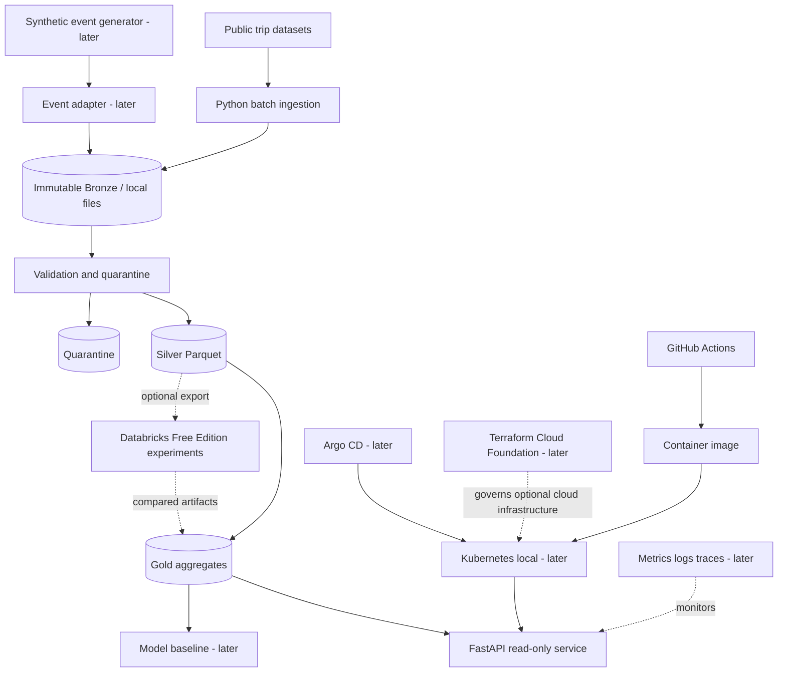

# System Design v0.2

Status: proposed; diagrams describe intended components, not deployed resources.

## Architectural principles
1. Solve a business problem before adding a platform component.
2. Maintain an executable local reference path independent of third-party free tiers.
3. Separate raw public records, synthetic events, curated datasets and derived model predictions.
4. Version contracts and capture lineage, checksums, run IDs and failure states.
5. Favor modular boundaries and testability over premature microservices.
6. Enforce least privilege, measurable recovery and budget-aware infrastructure.

## Context and containers

## Data boundaries
- Public trips: recorded source and dataset version; no claim of per-second truck sensor telemetry.
- Synthetic events: synthetic=true, generator version, seed, generated_at; never used to claim observed real-world predictive accuracy.
- Bronze: immutable original bytes with checksum and manifest.
- Silver: typed rows and quality outcomes; preserve source lineage.
- Gold: reproducible aggregates, clearly defined denominators and filters.
- ML: separate training/evaluation artifacts and leakage checks.

## Operational boundaries
- Local development: Python, Parquet, DuckDB, FastAPI, Docker Compose.
- Analytical sandbox: Databricks Free Edition only when capability and data-sharing limitations are checked. Export/import is explicit; not synchronous serving dependency.
- Platform lab: kind/k3d, GitHub Actions, Argo CD, Prometheus/Grafana and runbooks, progressively.
- Cloud foundation: AWS Organizations/Control Tower/AFT architecture and policy exercises first; real deployment gated by account access, security review and approved budget.

## Security and threat model seeds
Threats: dataset poisoning, malicious inputs, exposed credentials, unsafe IaC defaults, overprivileged CI, supply-chain vulnerabilities, inadvertent cloud spend. Controls: bounded inputs, schema validation, checksums, no secret commits, pinning, least-privilege workflows, static scans, budget alarms and cleanup procedures.

## Failure modes
Source unavailable -> fail with no advancement; invalid schema -> quarantine; interrupted write -> no partial published artifact; repeated ingest -> idempotent; API dataset missing -> explicit unavailable response; Databricks unavailable -> local path remains functional; GitOps drift -> observable and reversible.

## Architecture decision records to create
ADR-0001 modular monolith; ADR-0002 local Parquet/DuckDB; ADR-0003 immutable provenance; ADR-0004 Databricks optional adapter; ADR-0005 Docker before Kubernetes; ADR-0006 staged cloud provisioning; ADR-0007 security and cost gates.

## Open decisions
Dataset license and pinned sample; dataset schema; storage layout; exact cloud account access; acceptable spend; Databricks Free Edition capability test; target SLO after measurement.
