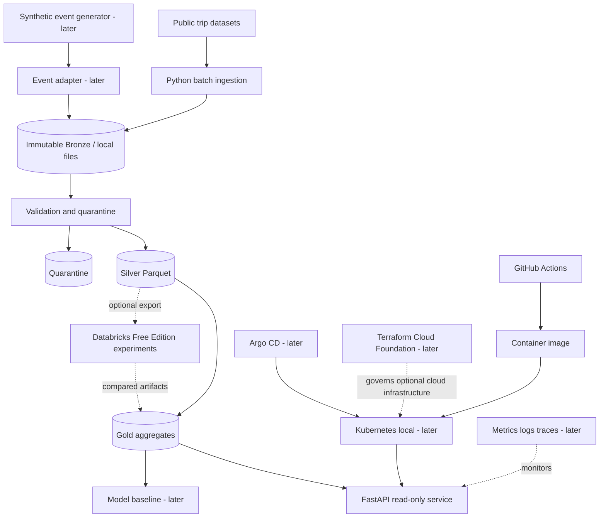

# System Design v0.2

Status: local reference, not a production deployment. The diagram mixes components that exist with components marked `later`. Bronze, Silver, Gold, the read-only FastAPI routes, `cfi serve`, `cfi diagnose`, and stderr JSON events are implemented and covered by tests. The Linux image is defined in the repository and was built in the CI container job. Workflow run `39699852347` on commit `631e65e6b88fd71c4f2c74727dc6974c58181804` built that image and ran the synthetic batch path plus `GET /health/live` and `GET /v1/trips/summary`. That run is not production operation. Cloud resources, Kubernetes, and a public authenticated API are not deployed.

Present limits: storage is a local filesystem; exclusive rename requires the same filesystem; NFS and CIFS are out of scope; there is no measured durability after power loss; there is no continuous ingestion and no distributed execution; the HTTP API has no authentication and is not for public exposure; the exercised dataset is synthetic; DuckDB errors while writing Parquet are not classified as `storage_error`.

## Architectural principles
1. Solve a business problem before adding a platform component.
2. Maintain an executable local reference path independent of third-party free tiers.
3. Separate raw public records, synthetic events, curated datasets and derived model predictions.
4. Version contracts and capture lineage, checksums, run IDs and failure states.
5. Favor modular boundaries and testability over premature microservices.
6. Enforce least privilege, measurable recovery and budget-aware infrastructure.

## Context and containers

Implemented and tested: batch ingestion, local Bronze, Silver, quarantine, Gold, the FastAPI read routes, `cfi serve`, `cfi diagnose`, and stderr JSON events. Validated in the CI container job named above: image build, synthetic ingest, transform, and gold, then `GET /health/live` and `GET /v1/trips/summary` from `cfi serve`. Documented and not executed as production: the local lab procedure, the diagnostic runbook, and the event format. `cfi diagnose` is not part of that container job. Planned or out of scope in the current tree: the synthetic event stream, Databricks export, the model baseline, Kubernetes, Argo CD, a metrics platform, and Terraform.

## Data boundaries
- Public trips: recorded source and dataset version; no claim of per-second truck sensor telemetry.
- Synthetic events: synthetic=true, generator version, seed, generated_at; never used to claim observed real-world predictive accuracy.
- Bronze: immutable original bytes with checksum and manifest v1. One published directory exists per `(source_id, dataset_version)` under `{data_root}/bronze/sources/`. The checksum is sealed in the manifest and is not a directory name. A same-volume temporary directory under `{data_root}/bronze/.incoming/` is renamed onto that path only when the destination is absent. An OS-held lock, one per source identity, lives at `{data_root}/bronze/locks/`. The vertical slice records the field list, CLI, limits, and recovery. This layout was exercised on Windows and on WSL2 Linux. It is local filesystem storage, not a deployed lake.
- Silver: one generation directory per `(source_id, dataset_version, input_sha256, contract_version, transform_version)`, named by the SHA-256 `storage_key` described in the vertical slice. It holds `silver.parquet`, `quarantine.parquet`, and `manifest.json`. DuckDB 1.5.6 writes ZSTD Parquet from an in-memory connection. `pickup_at` and `dropoff_at` are normalized to UTC before persistence. Instants use `TIMESTAMP` with microsecond precision and no time zone. Readers must interpret those components as UTC. `TIMESTAMP WITH TIME ZONE` is not the physical type. There is no current-Silver pointer. This layout was exercised on Windows and on WSL2 Linux. It is local filesystem storage, not a deployed lake.
- Gold: one immutable JSON snapshot per `(source_id, dataset_version, input_sha256, contract_version, transform_version, gold_contract_version, aggregate_version)`, named by the SHA-256 described in the vertical slice. It holds `summary.json` and `manifest.json`. DuckDB reads the Silver Parquet files. The totals are Python decimal arithmetic. One `current.json` pointer exists per `(source_id, dataset_version)`. Snapshot publication reuses exclusive directory rename. Pointer replacement uses `os.replace` for that one file. This layout was exercised on Windows and on WSL2 Linux. It is local filesystem storage, not a deployed lake. The read route opens the pointer once and then the named snapshot. It does not import DuckDB.
- ML: separate training and evaluation artifacts and leakage checks. None of those artifacts are in this tree.

## Operational boundaries
- Local development: Python, Parquet, DuckDB, FastAPI, and one Linux image. Batch is a short `cfi` container. The API is a separate `cfi serve` container. Both use a local volume at `/data`. The image was built and the synthetic path was run in CI run `39699852347`. That is not a high-availability deployment and it is not a claim of durability after power loss. NFS and CIFS are out of scope. There is no continuous ingestion and no distributed execution.
- Operational events: batch commands and the HTTP application write JSON Lines to stderr. Stdout remains the machine result. The lines name `command_started`, `command_finished`, and `http_request`. Uvicorn lifecycle lines are separate JSON objects with `logger` `uvicorn` and do not carry the bind address. `succeeded` with `dry_run` `true` is a decision, not a stored publication. These lines are not distributed traces, and this process does not export them to a collector. `GET /health/live` does not read Gold. There is no `/metrics` route and no readiness route. `cfi diagnose` reads one identity without writing and does not open DuckDB. The procedure is `docs/operations/diagnostics.md`.
- Storage failures at the covered write boundaries: ENOSPC, EIO, EACCES, and EROFS while creating a temporary directory, opening a file for write, writing it, or syncing that file are `storage_error`, exit 4. Gold is `rejected` with `snapshot_durable` false before the snapshot rename, and `partial` with `snapshot_durable` true when the snapshot already exists and the pointer update fails. A process exit before rename leaves the final directory absent. A process exit after publication leaves that artifact in place. Replay does not rewrite it. A directory under `.incoming` and a lock marker may remain. Directory sync failure is ignored. DuckDB errors while writing Parquet stay outside this classification. None of this is a power-loss result. The HTTP service has no authentication; the default bind is loopback, and `0.0.0.0` is only for a container that publishes the port. It is not an authenticated public API.
- Analytical sandbox: Databricks Free Edition only when capability and data-sharing limitations are checked. Export/import is explicit; not synchronous serving dependency. No Databricks run is recorded here.
- Platform lab: GitHub Actions `quality`, `test`, and `container` are present and have the successful run cited above. kind/k3d, Argo CD, and Prometheus/Grafana are not in this repository.
- Cloud foundation: not approved and not deployed. The earlier sketch named AWS Organizations, Control Tower, and AFT only after account access, a security review, and an approved budget.

## Security and threat model seeds
Threats: dataset poisoning, malicious inputs, exposed credentials, unsafe IaC defaults, overprivileged CI, supply-chain vulnerabilities, inadvertent cloud spend. Controls present in the tree: bounded inputs, schema validation, checksums, no secret commits, pinned dependencies, and a workflow permission of `contents: read`. Static scans, budget alarms, and a threat-model record are not implemented. The API has no authentication.

## Failure modes
Source unavailable -> fail with no advancement; invalid schema -> quarantine; interrupted Bronze or Silver rename -> no partial published directory; a Gold snapshot can remain when the later pointer update fails, and a later `cfi gold` can create the missing pointer without rewriting the snapshot; repeated ingest -> idempotent; missing Gold pointer -> HTTP 404 `not_published`; corrupt pointer or snapshot -> HTTP 503; allowlisted write errno values -> exit 4 `storage_error`; DuckDB write I/O -> not classified here; Databricks unavailable -> the local path does not call Databricks; GitOps drift is not observable here because GitOps is not deployed.

## Architecture decision records to create
ADR-0001 modular monolith; ADR-0002 local Parquet/DuckDB; ADR-0003 immutable provenance; ADR-0004 Databricks optional adapter; ADR-0005 Docker before Kubernetes; ADR-0006 staged cloud provisioning; ADR-0007 security and cost gates.

## Open decisions
Dataset license and pinned sample; public-sample field mapping; API storage; exact cloud account access; acceptable spend; Databricks Free Edition capability test; target SLO after measurement. The Bronze directory layout, the Silver generation layout, and the Gold snapshot and pointer layout are no longer open: they are the layouts in the vertical slice.
