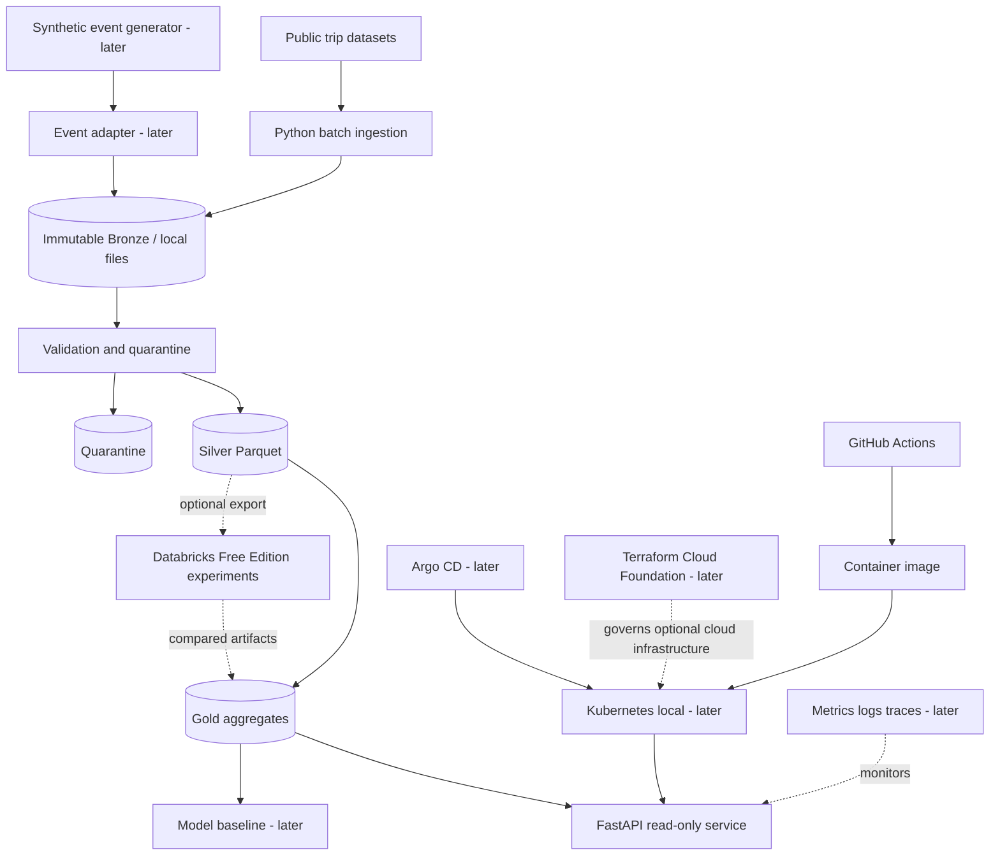

# System Design v0.2

Status: proposed. The diagram describes intended components, not deployed resources. Local Bronze ingestion, local Silver transformation, local Gold publication, the in-process read-only FastAPI routes, and `cfi serve` are implemented. A Linux image definition is in the repository. That image has not been executed here. Cloud resources are not.

## Architectural principles
1. Solve a business problem before adding a platform component.
2. Maintain an executable local reference path independent of third-party free tiers.
3. Separate raw public records, synthetic events, curated datasets and derived model predictions.
4. Version contracts and capture lineage, checksums, run IDs and failure states.
5. Favor modular boundaries and testability over premature microservices.
6. Enforce least privilege, measurable recovery and budget-aware infrastructure.

## Context and containers

## Data boundaries
- Public trips: recorded source and dataset version; no claim of per-second truck sensor telemetry.
- Synthetic events: synthetic=true, generator version, seed, generated_at; never used to claim observed real-world predictive accuracy.
- Bronze: immutable original bytes with checksum and manifest v1. One published directory exists per `(source_id, dataset_version)` under `{data_root}/bronze/sources/`. The checksum is sealed in the manifest and is not a directory name. A same-volume temporary directory under `{data_root}/bronze/.incoming/` is renamed onto that path only when the destination is absent. An OS-held lock, one per source identity, lives at `{data_root}/bronze/locks/`. The vertical slice records the field list, CLI, limits, and recovery. This layout was exercised on Windows and on WSL2 Linux. It is local filesystem storage, not a deployed lake.
- Silver: one generation directory per `(source_id, dataset_version, input_sha256, contract_version, transform_version)`, named by the SHA-256 `storage_key` described in the vertical slice. It holds `silver.parquet`, `quarantine.parquet`, and `manifest.json`. DuckDB 1.5.6 writes ZSTD Parquet from an in-memory connection. `pickup_at` and `dropoff_at` are normalized to UTC before persistence. Instants use `TIMESTAMP` with microsecond precision and no time zone. Readers must interpret those components as UTC. `TIMESTAMP WITH TIME ZONE` is not the physical type. There is no current-Silver pointer. This layout was exercised on Windows and on WSL2 Linux. It is local filesystem storage, not a deployed lake.
- Gold: one immutable JSON snapshot per `(source_id, dataset_version, input_sha256, contract_version, transform_version, gold_contract_version, aggregate_version)`, named by the SHA-256 described in the vertical slice. It holds `summary.json` and `manifest.json`. DuckDB reads the Silver Parquet files. The totals are Python decimal arithmetic. One `current.json` pointer exists per `(source_id, dataset_version)`. Snapshot publication reuses exclusive directory rename. Pointer replacement uses `os.replace` for that one file. This layout was exercised on Windows and on WSL2 Linux. It is local filesystem storage, not a deployed lake. The read route opens the pointer once and then the named snapshot. It does not import DuckDB.
- ML: separate training/evaluation artifacts and leakage checks.

## Operational boundaries
- Local development: Python, Parquet, DuckDB, FastAPI, and one Linux image with two processes. Batch is a short `cfi` container. The API is a separate `cfi serve` container. Both use a local volume at `/data`. The image definition is in the repository and has not been executed here. It is not a high-availability deployment and it is not a claim of durability after power loss. NFS and CIFS are out of scope.
- Analytical sandbox: Databricks Free Edition only when capability and data-sharing limitations are checked. Export/import is explicit; not synchronous serving dependency.
- Platform lab: kind/k3d, GitHub Actions, Argo CD, Prometheus/Grafana and runbooks, progressively.
- Cloud foundation: AWS Organizations/Control Tower/AFT architecture and policy exercises first; real deployment gated by account access, security review and approved budget.

## Security and threat model seeds
Threats: dataset poisoning, malicious inputs, exposed credentials, unsafe IaC defaults, overprivileged CI, supply-chain vulnerabilities, inadvertent cloud spend. Controls: bounded inputs, schema validation, checksums, no secret commits, pinning, least-privilege workflows, static scans, budget alarms and cleanup procedures.

## Failure modes
Source unavailable -> fail with no advancement; invalid schema -> quarantine; interrupted Bronze or Silver rename -> no partial published directory; a Gold snapshot can remain when the later pointer update fails; repeated ingest -> idempotent; missing Gold pointer -> HTTP 404 `not_published`; corrupt pointer or snapshot -> HTTP 503; Databricks unavailable -> local path remains functional; GitOps drift -> observable and reversible.

## Architecture decision records to create
ADR-0001 modular monolith; ADR-0002 local Parquet/DuckDB; ADR-0003 immutable provenance; ADR-0004 Databricks optional adapter; ADR-0005 Docker before Kubernetes; ADR-0006 staged cloud provisioning; ADR-0007 security and cost gates.

## Open decisions
Dataset license and pinned sample; public-sample field mapping; API storage; exact cloud account access; acceptable spend; Databricks Free Edition capability test; target SLO after measurement. The Bronze directory layout, the Silver generation layout, and the Gold snapshot and pointer layout are no longer open: they are the layouts in the vertical slice.
